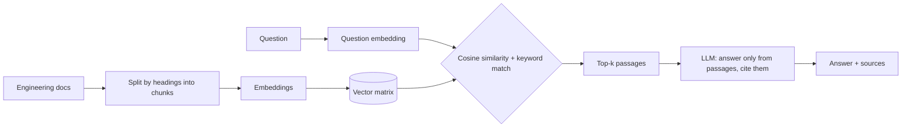

# ⚡ Electrical Design Docs Assistant (RAG)

A Retrieval-Augmented Generation (RAG) assistant that answers questions about **electrical design standards** — cabinet layout, wire colours, cable cross-sections, reference designations, PLC I/O conventions and the project release workflow — and shows **which document and section** every answer comes from.

It is a proof of concept for how an AI assistant could help engineers find information in internal documentation (for example around an EPLAN-based design process) instead of searching through PDFs.

> The six documents in `data/` are **fictional sample guidelines** of "Demo Automation GmbH", written for this demo. They are not real design rules and contain no third-party documentation.

## How it works



1. **Indexing (once at start-up):** each Markdown document is split along its `##` headings, so every chunk is one meaningful section. Each chunk is turned into an embedding vector.
2. **Retrieval:** the question is embedded and compared with all chunks using cosine similarity. A small keyword score is added, which helps with exact codes such as `-K12` or `2.5 mm²`.
3. **Generation:** the best passages are numbered and sent to the LLM with the instruction to answer **only** from them, cite them as [1], [2] and say so when the documents don't cover the question.

## Stack
- Python, Streamlit
- OpenAI Python library pointed at **Google Gemini's OpenAI-compatible API** (free tier) — switching to OpenAI or another provider only needs a different key, base URL and model name
- `gemini-embedding-001` for embeddings, Gemini Flash for answers
- NumPy for vector search (no vector database needed at this size)

## Run locally

```bash
python -m venv .venv
.venv\Scripts\activate          # Windows
# source .venv/bin/activate     # macOS/Linux
pip install -r requirements.txt
copy .env.example .env          # then put your key into .env
streamlit run app.py
```

Get a free Gemini API key at https://aistudio.google.com/apikey.

## Deploy (Streamlit Community Cloud, free)
1. Sign in at https://share.streamlit.io with GitHub → **Create app** → pick this repo, branch `main`, file `app.py`.
2. Under **Advanced settings → Secrets**, add:
   ```toml
   GEMINI_API_KEY = "your key"
   ```
3. Deploy.

## Possible next steps
- Load PDFs and Word documents, keep page numbers for citations
- Persist embeddings in a vector database (e.g. pgvector) instead of re-embedding at start-up
- Access control per document, feedback buttons, evaluation set of questions with expected sources
- Connect to project data (parts, devices) — see the companion project *tool-calling-support-agent*
